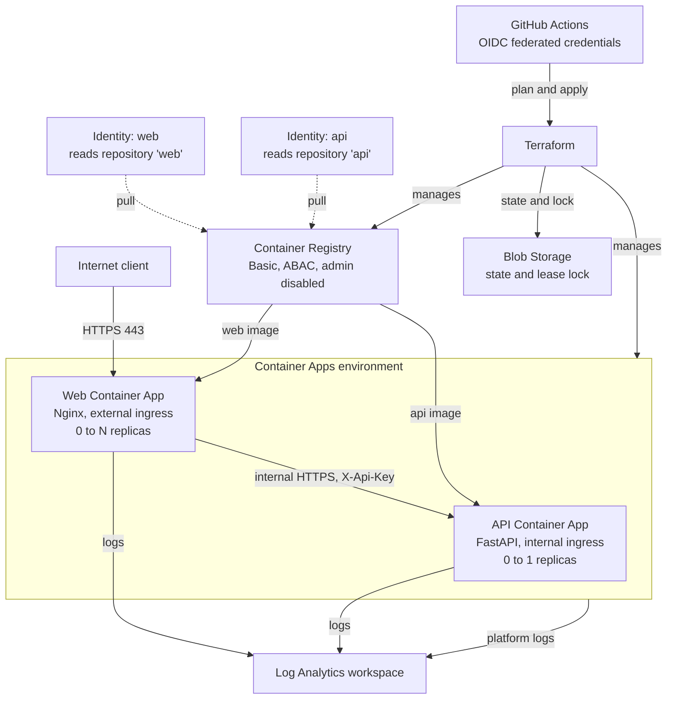
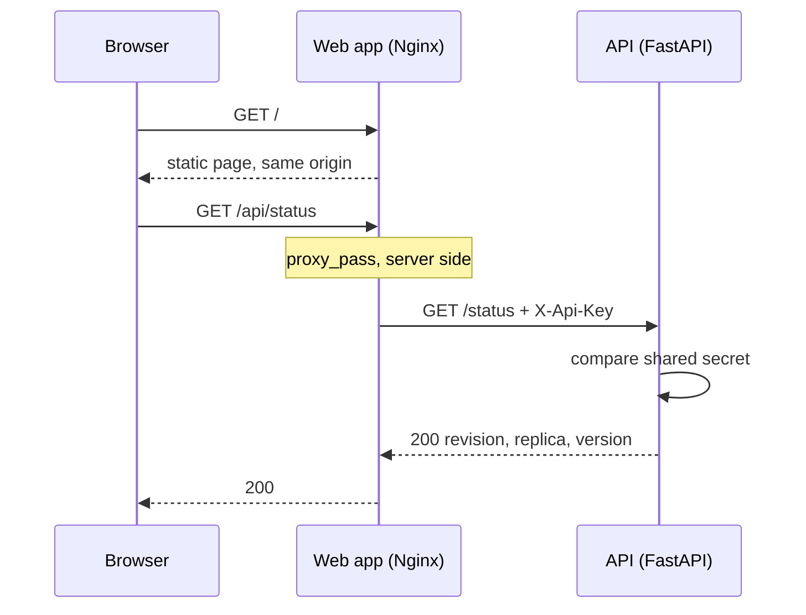

# Architecture

How the platform is put together, what talks to what, and which boundary stops what.

This describes the completed lab, whose environment has been torn down. The retained code and
evidence record its behavior; [What is deliberately absent](#what-is-deliberately-absent) marks
features outside that implementation.

## Components

| Component | Resource | Notes |
|---|---|---|
| Web app | `azurerm_container_app` | Nginx, external HTTPS ingress, 0 to N replicas |
| API | `azurerm_container_app` | FastAPI, internal ingress only, 0 to 1 replicas |
| Environment | `azurerm_container_app_environment` | Consumption plan, shared by both apps |
| Registry | `azurerm_container_registry` | Basic tier, admin user disabled, ABAC repository permissions |
| Identities | `azurerm_user_assigned_identity` | One per app, each scoped to a single repository |
| Logs | `azurerm_log_analytics_workspace` | 30 day retention, receives app and platform logs |
| State | Azure Blob Storage | Terraform state with lease based locking |



## The request path

A browser only ever talks to one origin. The API's hostname never reaches client code.



The proxy happens inside the web container rather than in the browser. Three consequences follow:

1. Every request the browser makes goes to its own origin, so no CORS configuration exists anywhere in the system.
2. The API hostname is never exposed to client code.
3. Protected API routes require the shared secret supplied by Nginx. `/health` is exempt.
   This authenticates a service call, not a browser user: public clients can use the proxy route.

## Boundaries

Three separate controls, each doing a different job.

**Network.** The API sets `external_enabled = false`. Its hostname resolves publicly, but managed
ingress returns `404` for requests from outside the environment before they reach the FastAPI
container. The public route to the API in this deployment is the Nginx proxy. Internal ingress
alone does not restrict callers to that app; other apps in the
environment can reach the API endpoint.

**Authentication between the apps.** Terraform generates a 48 character shared secret with `random_password`, stores it as a Container App secret on both apps, and never writes it to Git. Nginx sends it as `X-Api-Key` on every proxied request. The API requires it on every route except `/health`, which the platform probes call directly.

**Registry access.** Each app has its own identity holding `Container Registry Repository Reader`, restricted by an ABAC condition to one repository:

```text
(
 (
  !(ActionMatches{'...repositories/content/read'})
  AND
  !(ActionMatches{'...repositories/metadata/read'})
 )
 OR
 (
  @Request[...repositories:name] StringEqualsIgnoreCase 'web'
 )
)
```

This is Azure RBAC with ABAC conditions. The Reader role grants repository-read operations;
the ABAC condition narrows content and metadata reads using the repository-name attribute.
Without the condition, the role is registry-wide. The condition does not grant additional
operations beyond those permitted by the role.

The registry sets `admin_enabled = false`; app image pulls use managed identities.

## Scaling and revisions

Both apps scale from zero. The web app scales to `var.web_max_replicas` on an HTTP rule measuring concurrent requests. The API is capped at one replica, since nothing needs more.

Scale to zero is why the platform is cheap and also why there is often nothing running to inspect. An `az containerapp exec` against an idle app fails with no replica found until a request wakes it.

The web app runs in `Multiple` revision mode so traffic can be split:

```hcl
revision_suffix = "${replace(var.image_tag, ".", "-")}-${local.config_hash}"
```

The suffix combines the version with a six character hash of the values that should force a new revision: image tag, max replicas, concurrent requests, and upstream FQDN. The tag alone repeats when only configuration changes, which would leave a revision serving stale settings under a name implying otherwise.

`max_inactive_revisions = 5` retains inactive revision configuration; it does not keep replicas
running. Traffic weights select active revisions in multiple-revision mode. A retained inactive
revision must be activated before it can receive traffic; no image rebuild is needed.

Both containers carry startup, readiness, and liveness probes on `/health`, all on port 8080.

## Delivery

Two Terraform roots with different trust levels.

| Root | Applied by | Holds |
|---|---|---|
| `terraform/bootstrap/state-backend` | A human | State backend, CI identity, federated credentials, app identities and their role assignments |
| `terraform/` | GitHub Actions | Resource group, environment, registry, both apps |

The pipeline identity holds Contributor, which deliberately excludes managing role assignments. So anything that grants access lives in the root a human applies, and the pipeline only reads those identities through a data source.

Contributor still permits deletion of the registry and both apps. The separation restricts
role-assignment changes; it does not prevent destructive infrastructure changes.

Authentication to Azure uses OIDC federated credentials rather than a stored client secret.
The deploy job targets the GitHub `dev` environment, whose protection rules gate approval. Its
federated credential trusts the environment-specific subject; that subject is an identity claim,
not the approval mechanism itself.

Pull requests run lint and security/image scans. Terraform changes also trigger format, validate,
and an authenticated plan posted as a comment. Merges matching the deploy workflow's path filters
trigger image publication, apply, and a smoke test after environment approval. Documentation-only
changes do not trigger deployment.

Both workflows share a `terraform-state` concurrency group, so plans and applies queue rather than collide on the state lease.

## Observability

The environment sends platform logs to Log Analytics, and both apps send application logs there. Retention is 30 days.

Nginx implements the IPv4 truncation in its custom access-log format, using the forwarded client
address to retain a `/24` prefix. Its proxy clears `X-Forwarded-For` on API calls. FastAPI's
request middleware logs path, status, and duration without addresses; Uvicorn access logging is
disabled. These application choices reduce identifying detail; they do not make all platform
logs anonymous.

## What is deliberately absent

**Custom VNet integration.** No customer VNet is configured in this lab. Internal ingress is
scoped to the Container Apps environment; it does not establish a customer-managed subnet
boundary. VNet integration and scale-to-zero are separate design choices: integration does not
itself disable application scale-to-zero. The registry and state account use authenticated
public endpoints, not Private Link.

**A database.** Neither application holds state, so none is deployed.

**Microsoft Sentinel.** Detection rules on top of the workspace remain a potential addition.

Reasoning for these, with the alternatives that were rejected, is in the [decision log](decisions.md).
